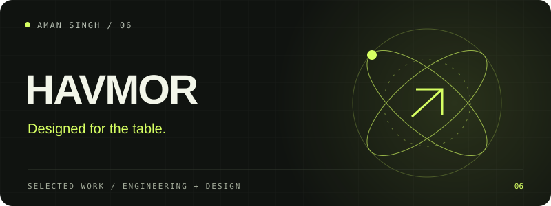

# HAVMOR

A print-focused restaurant menu, authored in HTML and CSS with A4-oriented layouts.

**HTML / Print CSS**

## What is included

A completed print design deliverable. This repository contains the editable HTML layouts; it is not a restaurant ordering application.

## Local setup

Open `menu.html` in a browser, then use the print dialog with A4 paper. Disable browser headers and footers and enable background graphics. Check pagination on your printer before a production print run.

## Source and configuration

This repository is a source release. Local credentials, session cookies, personal records, databases, dependency directories and generated build files are excluded. See [SECURITY.md](SECURITY.md) before configuring integrations or contributing.

Current integration availability and physical-device behavior must be verified in your own environment. Historical project checks are not a promise that every external service works today.

---

Built by [Aman Singh](https://github.com/aman-singh27) · [More work](https://github.com/aman-singh27/aman-singh27/blob/main/PROJECTS.md)
